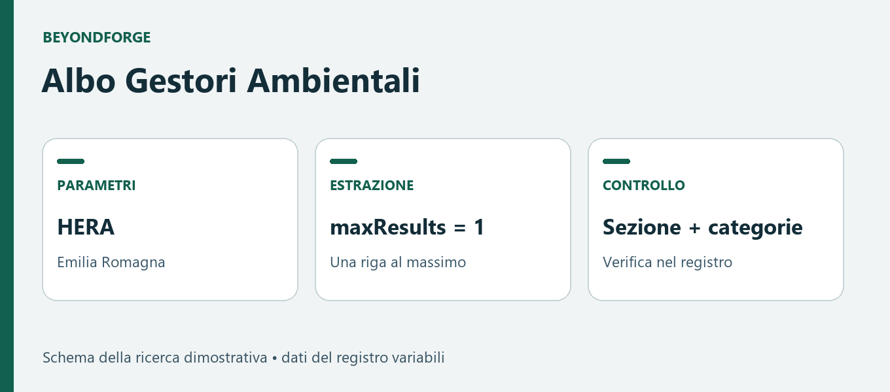

# Verifica iscrizione Albo Gestori Ambientali prima dell’affidamento

Cerca un’impresa negli elenchi dell’Albo per nome e sezione. Un esempio per chi qualifica fornitori e vuole risalire alle categorie restituite dalla fonte ufficiale.



## Come provarlo

1. Apri l’esempio con la ricerca per denominazione. L’input allegato limita l’estrazione a un risultato in Emilia Romagna.
2. Confronta denominazione, identificativi, sezione e categorie della riga con il fornitore che devi valutare. In caso di omonimia ripeti una ricerca mirata con il codice fiscale o la partita IVA dell’impresa.
3. Annota la data e controlla la scheda negli elenchi ufficiali prima della decisione. Nel `RUN_SUMMARY`, `maxResults` indica che il limite ha interrotto la ricerca. `endOfResults` identifica la fine dei risultati.

La figura mostra i parametri della ricerca di esempio. Il registro può cambiare; una singola riga non costituisce certificazione e il filtro per nome può includere omonimi.

## Piani e addebiti

Il piano Free ammette fino a 10 record. Il limite richiesto può arrivare a 10.000 su Paid. Il listino prevede 0,005 USD per record e 0,00005 USD per avvio a 256 MB.

**Una ricerca vuota basta per escludere un fornitore?** Verifica l’esito della run, la sezione e gli identificativi. Una fonte indisponibile richiede un nuovo controllo. Per l’atto di qualificazione consulta il registro ufficiale.

## API e agenti AI

Questa richiesta GET legge la scheda pubblica senza avviare il servizio.

```sh
curl --fail --silent --show-error "https://api.apify.com/v2/actors/beyondforge~albo-gestori-ambientali"
```

Con Apify MCP puoi chiedere

> Usa fetch-actor-details per beyondforge/albo-gestori-ambientali. Riassumi filtri di ricerca, limiti e tariffa dell’Actor. Mostrami lo schema senza avviare una run.

[Apri la ricerca per nome in Emilia Romagna](https://apify.com/beyondforge/albo-gestori-ambientali/examples/cerca-azienda-albo-gestori-ambientali-emilia-romagna) · [Input di esempio](inputs/albo-gestori-ambientali.json) · [Apify Store](https://apify.com/beyondforge/albo-gestori-ambientali) · [Apify MCP](https://docs.apify.com/mcp) · [Elenchi ufficiali dell’Albo](https://www.albonazionalegestoriambientali.it/Public/ElenchiIscritti)
