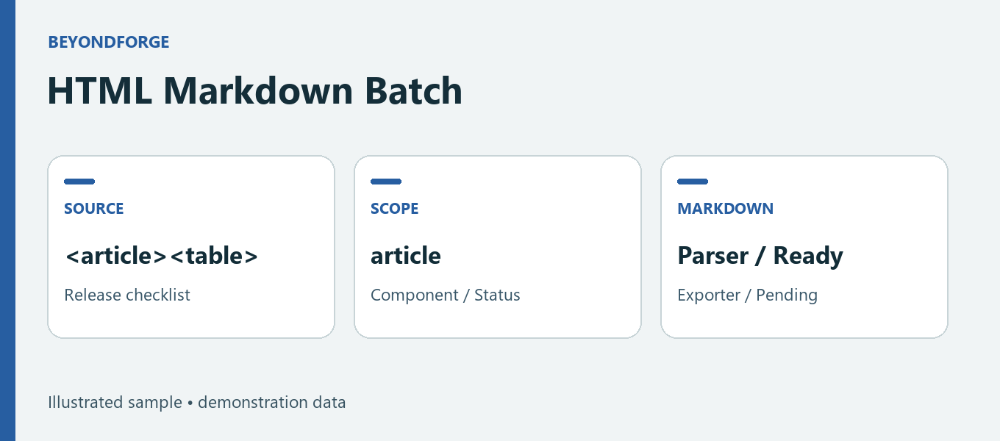

# Convert HTML table to Markdown for a release handoff

Turn a two-row release checklist inside an HTML article into a Markdown table that a documentation team can paste into its release notes.



## Try the example

1. Pass the inline HTML in the example input. It encloses the release checklist in an `<article>` and selects `scope: article`.
2. Read the `markdown` field. The `Component` and `Status` columns have two data rows. Copy that field directly into the release notes.
3. Review the final table in your target renderer. Repeat the conversion when the authorized source changes. For multiple documents keep a stable input ID for each one.

The fixture delivers a Markdown table containing `Parser | Ready` and `Exporter | Pending` in their original order.

## Plans and charges

Free accepts one inline HTML document up to 8,000 bytes. Paid accepts up to 40 documents at up to 160,000 bytes each, subject to the total input limit. USD 0.004 per delivered document plus USD 0.00005 per start at 256 MB.

**Will linked resources be fetched?** Supply the HTML itself. The conversion uses the chosen part of the document and can run on markup exported from your own system.

## API and AI agents

This GET reads the public Actor record without starting a run.

```sh
curl --fail --silent --show-error "https://api.apify.com/v2/actors/beyondforge~html-markdown-batch"
```

In an Apify MCP client, ask

> Use fetch-actor-details for beyondforge/html-markdown-batch. Show the input schema, output and price so I can review this example. Stop before starting a run.

[Open the HTML table example](https://apify.com/beyondforge/html-markdown-batch/examples/html-table-to-markdown) · [Sample input](inputs/html-markdown-batch.json) · [Apify Store](https://apify.com/beyondforge/html-markdown-batch) · [Apify MCP](https://docs.apify.com/mcp)
