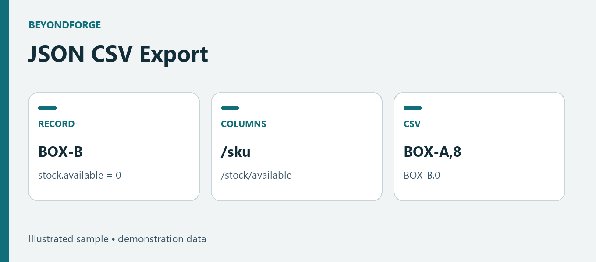

# Nested JSON to CSV with a stable warehouse handoff

Flatten nested inventory records into a predictable two-column CSV and preserve zero stock for downstream warehouse imports.



## Try the example

1. Use the input fixture containing two synthetic SKUs. Its explicit JSON Pointer columns are `/sku` and `/stock/available`.
2. Read the dataset row’s `csv` field as text and save its contents as your CSV file. Preserve the header and the numeric zero for `BOX-B`.
3. Use the same column selection for subsequent files so the receiving team can import them predictably. Map blank cells and explicit zeros separately.

The result has `rowCount: 2`, the two requested columns in order, and records `BOX-A,8` and `BOX-B,0`.

## Plans and charges

Free accepts one table up to 15 records. Paid accepts up to 40 tables and 1,000 rows per table. USD 0.006 per exported table plus USD 0.00005 per start at 256 MB.

**Why did an exported dataset contain a quoted CSV inside a cell?** The Actor returns one dataset item per table. Write the text value of its `csv` property to the destination file.

## API and AI agents

This GET reads the public Actor record without starting a run.

```sh
curl --fail --silent --show-error "https://api.apify.com/v2/actors/beyondforge~json-csv-export"
```

In an Apify MCP client, ask

> Use fetch-actor-details for beyondforge/json-csv-export. Show the input schema, output and price so I can review this example. Stop before starting a run.

[Open the nested inventory export example](https://apify.com/beyondforge/json-csv-export/examples/flatten-nested-json-to-csv) · [Sample input](inputs/json-csv-export.json) · [Apify Store](https://apify.com/beyondforge/json-csv-export) · [Apify MCP](https://docs.apify.com/mcp)
