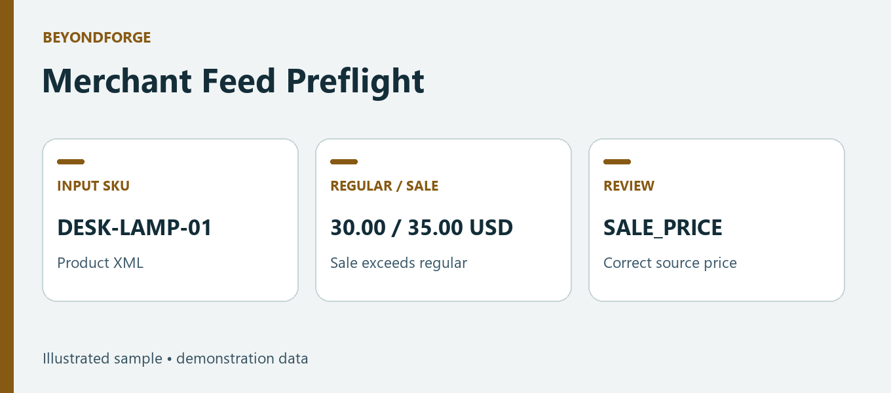

# Google Shopping XML feed validator for the last check before upload

Catch a sale price higher than the regular price in a Google Merchant Center XML feed. Use the SKU finding to decide whether an agency should hold the upload.



## Try the example

1. Inspect the synthetic XML fixture. SKU `DESK-LAMP-01` has a regular price of 30 USD and a sale price of 35 USD.
2. Open the XML example or paste the fixture into the Actor. Find the row for this offer and its `SALE_PRICE` finding. Pause the upload and correct the price in the source catalog.
3. Run your own next export only after completing the first check. Agencies can use the native n8n example to persist the decision and suppress a replay of the same export.

The Actor returns `status: review` for `DESK-LAMP-01`. The release workflow can use this finding to hold the export. A passing check covers the rules listed by the Actor; Google retains the destination approval decision.

### Check one SKU before the next upload

Open the [sample XML input](inputs/merchant-feed-preflight.json) and compare both prices for `DESK-LAMP-01`. Correct that offer in your source catalog before the next delivery. For an agency checking a Paid feed of 1,000 to 5,000 unique offers, the delivered offer events total USD 0.90 to USD 4.50. Add USD 0.00005 for one start at 256 MiB. Set the run budget for the intended number of results and check the delivered count before releasing the feed.

## Plans and charges

Free supports up to 25 unique inline offers. Paid supports up to 5,000 and an authorized public HTTPS feed. The list price is USD 0.00090 per unique offer result delivered, plus USD 0.00005 per start at 256 MB.

**Will the test edit my shop or upload products?** The Actor reports findings. A separate release step owned by your team controls the upload.

These figures are Actor event list prices. Check your plan for any separate charges for reading or retaining results after the run. [Apify billing details](https://docs.apify.com/actors/running/actors-in-store)

## API and AI agents

This GET reads the public Actor record without starting a run.

```sh
curl --fail --silent --show-error "https://api.apify.com/v2/actors/beyondforge~merchant-feed-preflight"
```

In an Apify MCP client, ask

> Use fetch-actor-details for beyondforge/merchant-feed-preflight. Show the input schema, output and price so I can review this example. Stop before starting a run.

[Open the XML feed validation example](https://apify.com/beyondforge/merchant-feed-preflight/examples/validate-google-merchant-xml-feed) · [Sample input](inputs/merchant-feed-preflight.json) · [Apify Store](https://apify.com/beyondforge/merchant-feed-preflight) · [Apify MCP](https://docs.apify.com/mcp) · [Native n8n Merchant workflow and setup](https://github.com/DarkSpike83/beyondforge-workflow-examples/tree/b1f4e02e15d5c4be0cbe7b45f626dbd82ba423fa/n8n/native)
