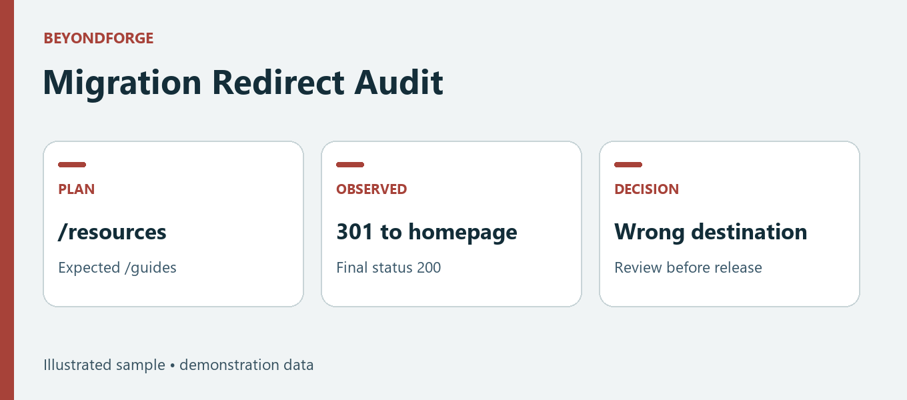

# 301 redirect mapping checks when the wrong destination returns 200

Compare planned 301 redirect targets with recorded crawl evidence. Catch migrations that return HTTP 200 on the wrong page before sign-off.



## Try the example

1. Start with the approved old-to-new URL mapping and an export of HTTP observations from an authorized crawl. The preview supplies both.
2. Follow the old `/resources` URL. A 301 reaches the new site’s homepage and ends with 200. The plan required `/guides`. Record the wrong destination even though the terminal status is healthy.
3. Fix the redirect in your own website, collect fresh crawl evidence and audit the matching map for release sign-off. Keep separate snapshots if you need regression comparison.

The synthetic example finishes at `https://new.example/` while the expected URL is `https://new.example/guides`. The Actor evaluates supplied observations; acquiring a current crawl remains part of the customer’s release process.

## Plans and charges

The built-in preview uses no `migration-audited` event. Custom maps require Paid. One completed full audit costs USD 2.75, including a clean audit. There is no separate fee per start, URL, hop or anomaly.

**Will it crawl the migrated site or apply redirects?** Supply your planned map and crawl observations. The result helps your team decide what to repair and recheck.

## API and AI agents

This GET reads the public Actor record without starting a run.

```sh
curl --fail --silent --show-error "https://api.apify.com/v2/actors/beyondforge~migration-redirect-audit"
```

In an Apify MCP client, ask

> Use fetch-actor-details for beyondforge/migration-redirect-audit. Show the input schema, output and price so I can review this example. Stop before starting a run.

[Open the wrong-destination preview](https://apify.com/beyondforge/migration-redirect-audit/examples/find-wrong-redirect-destinations) · [Sample input](inputs/migration-redirect-audit.json) · [Apify Store](https://apify.com/beyondforge/migration-redirect-audit) · [Apify MCP](https://docs.apify.com/mcp)
