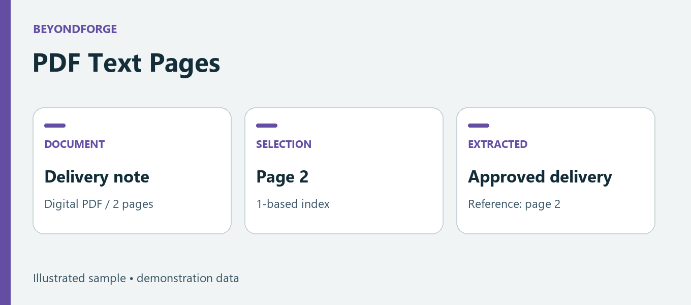

# Use a PDF to text API to preserve a page reference in a handoff

Extract a cited page from a text-layer PDF and retain its page number when handing document text to search, operations or editorial review.



## Try the example

1. Open the attached JSON fixture. It carries an authorized two-page digital PDF as Base64 and requests page 2.
2. Copy the JSON into the Actor. Read `page`, `documentPages` and `text` from the delivered row before handing a passage to a search index or review queue.
3. Store your own document identifier alongside that page number. Route image-only scans to your own OCR process when optical character recognition is needed.

The fixture returns `page: 2`, `documentPages: 2` and `Approved delivery`. A page filter helps keep a reference that an editor can check against the original.

### Try a digital page you can cite

Select a line of text in your PDF viewer. In the [two-page sample](inputs/pdf-text-pages.json), check that the page 2 result contains `Approved delivery`. Save the document ID with the page number so a colleague can find the passage later. For a Paid batch delivering ten qualifying pages, budget USD 0.01505 in Actor events with one 256 MiB start. The input limits below still apply to each PDF and to the whole batch.

## Plans and charges

Free supports one digital PDF up to 120,000 bytes and up to three selected pages. Paid supports up to 12 documents, up to 2,000,000 bytes per PDF and 60 selected pages each, subject to the total input limit. The list price is USD 0.0015 per extracted qualifying page plus USD 0.00005 per start at 256 MB.

**Can I submit a scan to read photographed text?** This tool reads a digital text layer. Provide a searchable PDF to obtain text rows.

These figures are Actor event list prices. Check your plan for any separate charges for reading or retaining results after the run. [Apify billing details](https://docs.apify.com/actors/running/actors-in-store)

## API and AI agents

This GET reads the public Actor record without starting a run.

```sh
curl --fail --silent --show-error "https://api.apify.com/v2/actors/beyondforge~pdf-text-pages"
```

In an Apify MCP client, ask

> Use fetch-actor-details for beyondforge/pdf-text-pages. Show the input schema, output and price so I can review this example. Stop before starting a run.

[Open the digital PDF text example](https://apify.com/beyondforge/pdf-text-pages/examples/extract-digital-pdf-text) · [Sample input](inputs/pdf-text-pages.json) · [Apify Store](https://apify.com/beyondforge/pdf-text-pages) · [Apify MCP](https://docs.apify.com/mcp)
