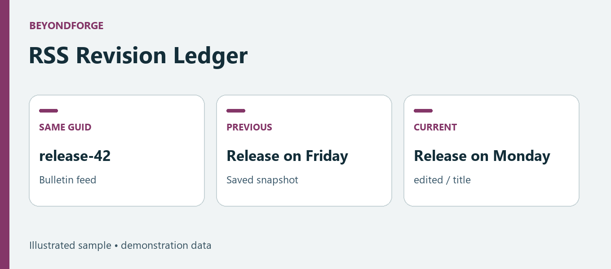

# RSS feed monitoring for headline corrections under the same GUID

Compare two RSS snapshots with the same GUID, identify an edited headline and send an actionable correction to the newsroom’s review queue.



## Try the example

1. Compare the two supplied RSS snapshots of the same feed. Their item uses the same GUID. The release date in the headline changes by one day.
2. Read `change` and `changedFields`. An editor can route this correction to the update queue without creating a second article.
3. Keep a separate checkpoint for each feed and tenant. Advance it only after a complete comparison. An unchanged complete comparison and a failed read require different actions.

The fixture returns one `edited` entry with `changedFields` containing only `title`. A previous-only item can simply have fallen outside the publisher’s feed window.

### Keep the previous feed snapshot

In the example, locate the edited item by GUID and compare its old and new title. Keep the earlier checkpoint until the comparison completes. At 256 MiB, one start and one delivered edit total USD 0.00105 in Actor events. If the newsroom needs a receipt even when nothing changes, Paid can opt in at USD 0.001 for each completed comparison. With no changes, that gives USD 0.00105 including the start, or USD 0.00005 with the receipt off.

## Plans and charges

Free supports inline comparisons up to 25 changes. Paid supports up to 5,000 changes and authorized feed URLs. Each change is USD 0.001, with USD 0.00005 per start at 256 MB. A Paid caller can opt in to a USD 0.001 receipt per completed comparison, including zero changes. This fixture omits the opt-in.

**Does disappearance prove an article was withdrawn?** Publishers can shorten rolling feeds. Review the original publication before treating an absent entry as a retraction.

These figures are Actor event list prices. Check your plan for any separate charges for reading or retaining results after the run. [Apify billing details](https://docs.apify.com/actors/store)

## API and AI agents

This GET reads the public Actor record without starting a run.

```sh
curl --fail --silent --show-error "https://api.apify.com/v2/actors/beyondforge~rss-revision-ledger"
```

In an Apify MCP client, ask

> Use fetch-actor-details for beyondforge/rss-revision-ledger. Show the input schema, output and price so I can review this example. Stop before starting a run.

[Open the headline-correction example](https://apify.com/beyondforge/rss-revision-ledger/examples/detect-rss-title-edits) · [Sample input](inputs/rss-revision-ledger.json) · [Apify Store](https://apify.com/beyondforge/rss-revision-ledger) · [Apify MCP](https://docs.apify.com/mcp)
