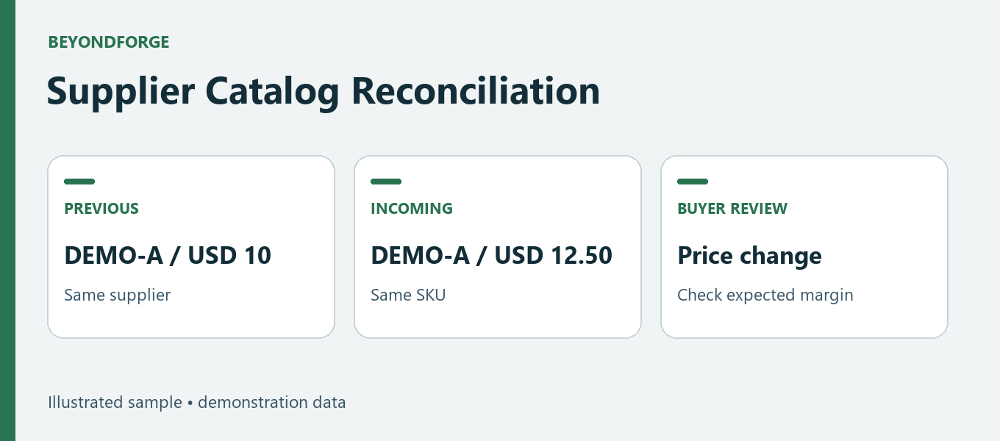

# Price list comparison for two exports from the same supplier

Compare the last accepted supplier catalog against its replacement by SKU, so a buyer can review price increases and decreases before import.



## Try the example

1. Choose one supplier. The baseline is the last catalog you accepted from that supplier. The incoming file is the new catalog the same supplier sent to your shop.
2. Open the price-change demo. Match by SKU. Compare old and new values and assign changes to the buyer before importing the replacement file.
3. When your team is ready to use its own data, set up a Paid comparison with explicit full-report pricing. Only promote a verified new baseline after a complete audit.

The synthetic demo has one SKU moving from USD 10 to 12.50 and another from USD 10 to 9. The relative direction matters when reviewing margin. Keep currency and pack size with the price.

### Whose catalog do I compare?

Use two price lists sent to your business by the same supplier. In the built-in preview, match the same SKU across both versions and confirm which price the buyer will pay next. When a replacement list arrives, use the last accepted list as the baseline and record both file dates with the report. Compare your own files on Paid when a full report is worth USD 0.85 to your team, including when all items agree.

### Check your own supplier CSV samples

Open the [CSV Validator for Supplier Price Lists](../supplier-workbench/own-data-preview.html) on GitHub, select **Download raw file** and open the saved HTML in your browser. Select one small sample from each of two successive price lists you are authorized to use from the same supplier. If the headers differ, map the columns for each file separately. The free tool checks SKU, stock, price and currency locally, including optional units and pack sizes. A complete comparison of stock, prices and assortment across the two lists is available in the Paid Actor.

## Plans and charges

The built-in preview uses no `catalog-reconciled` event. Own catalogs require Paid. One completed full report costs USD 0.85, including a clean report. There is no separate start, SKU or anomaly fee. Each custom snapshot supports up to 5,000 rows.

**Can this discover competing suppliers’ prices on the web?** The buyer supplies both snapshots. Compare what changed within that supplier’s file; use a different comparison for cross-supplier sourcing.

These figures are Actor event list prices. Check your plan for any separate charges for reading or retaining results after the run. [Apify billing details](https://docs.apify.com/actors/store)

## API and AI agents

This GET reads the public Actor record without starting a run.

```sh
curl --fail --silent --show-error "https://api.apify.com/v2/actors/beyondforge~supplier-catalog-reconciliation"
```

In an Apify MCP client, ask

> Use fetch-actor-details for beyondforge/supplier-catalog-reconciliation. Show the input schema, output and price so I can review this example. Stop before starting a run.

[Open the supplier price comparison preview](https://apify.com/beyondforge/supplier-catalog-reconciliation/examples/supplier-price-comparison-by-sku) · [Sample input](inputs/supplier-catalog-reconciliation.json) · [Apify Store](https://apify.com/beyondforge/supplier-catalog-reconciliation) · [Apify MCP](https://docs.apify.com/mcp) · [Worked supplier catalog example](https://github.com/DarkSpike83/beyondforge-workflow-examples/blob/f060a154fc77c3f19cad4597ff508de4e6cd2917/supplier-workbench/TUTORIAL.md)
